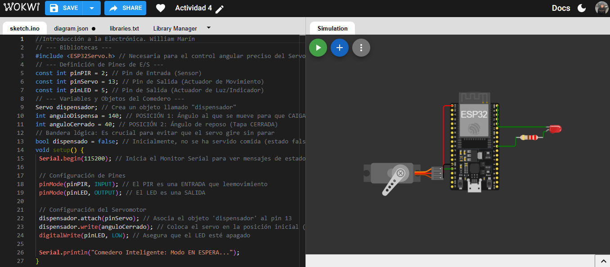

**Comedero Inteligente para Gatos**

Proyecto del curso: 
EL-1200 Introducción a la Electrónica, TEC, II semestre 2026.

**Integrantes:** Yamileth Estrada, Anne Campbell

**Descripción**

Comedero automático para gatos con ESP32, sensor PIR y servomotor, que sirve comida solo una vez por visita.
Muchos comederos automáticos sirven comida sin importar si el gato está presente, o siguen sirviendo mientras el gato se queda frente al plato. Este proyecto resuelve ese problema: dispensa alimento solo cuando detecta al gato y evita servir de más si el gato permanece frente al comedero.

**Funcionamiento**
- El sensor PIR detecta la presencia del gato.
- Al detectarlo, el ESP32 enciende el LED y el servomotor gira de la posición cerrada (40°) a la posición de dispensación (140°) para que caiga el alimento. Luego la compuerta vuelve a cerrarse.-
- El LED indica que se está sirviendo.
- Una variable booleana (dispensado) evita que se sirva otra vez mientras el gato sigue frente al sensor.-
- Después de servir, el sistema espera 10 segundos antes de volver a verificar el sensor, para evitar disparos repetidos.-
- Cuando el sensor deja de detectar movimiento, la variable se reinicia y el comedero queda listo para la próxima comida.-
- El Monitor Serial (115200 baudios) muestra mensajes de estado: "Modo EN ESPERA", "Gato detectado", "Dispensación completada" y "Sistema reiniciado".

**Conexiones del simulador**
Componente	Pin del ESP32
Sensor PIR	GPIO 2
Servomotor	GPIO 13
LED (con 220 Ω)	GPIO 5
Alimentación	3V3 y GND

**Simulación**

Proyecto en Wokwi: https://wokwi.com/projects/479733799379710977

**Código**

Ver la carpeta firmware/. Biblioteca usada: ESP32Servo.

**Evidencia**

**Mejoras futuras**

•	Agregar un sensor de nivel para avisar cuando el depósito de comida esté casi vacío.
•	Programar horarios de servicio para controlar la cantidad de comidas al día.
•	Enviar un aviso por Wi-Fi al celular cada vez que el gato come.
